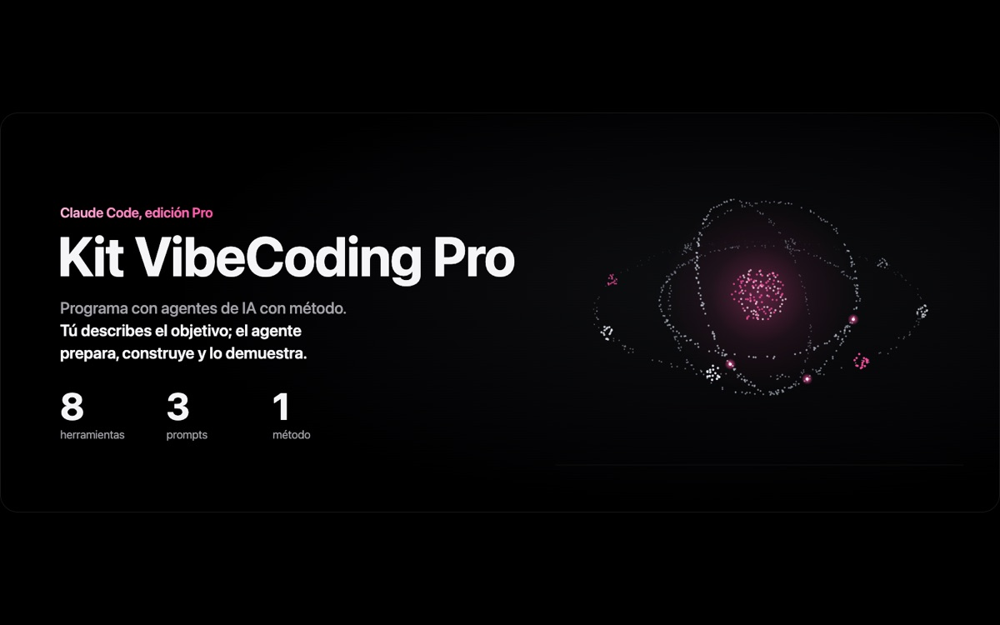

  &nbsp;
  &nbsp;
  

Paraguayo en Madrid, estudiante de **FP DAM en Ilerna**. Aprendo **Java** desde los cimientos y uso la **IA** como compañera para diseñar, revisar y entender cada línea de código.

 

<picture>
  <source media="(prefers-color-scheme: light)" srcset="assets/readme/label-01-light.svg">
  
</picture>

 

<picture>
  <source media="(prefers-color-scheme: light)" srcset="assets/readme/label-02-light.svg">
  
</picture>

 

<picture>
  <source media="(prefers-color-scheme: light)" srcset="assets/readme/label-03-light.svg">
  
</picture>

<table>
  <tr>
    <td width="50%" valign="top">
      
      <h3>Servitek</h3>
      Web corporativa de SERVITEK E.A.S., electromecánica industrial en Paraguay.
        
      <code>Next.js 14</code> <code>TypeScript</code> <code>Tailwind</code> <code>GitHub Actions</code>
        
      <a href="https://servitek.pages.dev"><b>Sitio en vivo ↗</b></a>&nbsp;&nbsp;·&nbsp;&nbsp;<a href="https://github.com/ivanvera7/servitek-web">Ver repo</a>
    </td>
    <td width="50%" valign="top">
      
      <h3>Solca Decoraciones</h3>
      Web para una empresa de decoración y ambientación de eventos en Paraguay.
        
      <code>Next.js 14</code> <code>TypeScript</code> <code>Tailwind</code> <code>Framer Motion</code>
        
      <a href="https://solca-decoraciones.vercel.app"><b>Sitio en vivo ↗</b></a>&nbsp;&nbsp;·&nbsp;&nbsp;<a href="https://github.com/ivanvera7/Solca-decoraciones">Ver repo</a>
    </td>
  </tr>
</table>

<table>
  <tr>
    <td width="50%" valign="top">
      
    </td>
    <td width="50%" valign="top">
      <h3>Kit VibeCoding Pro</h3>
      Herramientas, prompts y un método de 6 pasos para programar con agentes de IA en <b>Claude Code</b>, de la idea al código verificado.
        
      <code>Superpowers</code> <code>Context7</code> <code>RTK</code> <code>Graphify</code> <code>Next.js</code>
        
      <a href="https://github.com/ivanvera7/kit-vibecoding-pro"><b>Ver repo ↗</b></a>&nbsp;&nbsp;·&nbsp;&nbsp;<a href="https://github.com/ivanvera7/kit-vibecoding-pro/stargazers">⭐ Dale una estrella</a>
    </td>
  </tr>
</table>

<b>Ejercicios de Java</b> — 5 programas, ejecutables en <a href="https://ivanvera7.github.io/Ivanvera-web/#proyectos">mi web</a>

 

| | Ejercicio | Qué practico |
| :-: | --- | --- |
| `01` | [**Hola Mundo**](https://github.com/ivanvera7/Ejercicio1-HolaMundo) | El primer programa: imprime mi nombre y mi propósito en consola. |
| `02` | [**Variables**](https://github.com/ivanvera7/Ejercicio2-Variables) | Tipos `String`, `int` y `double`, y concatenación de texto. |
| `03` | [**Sumar**](https://github.com/ivanvera7/Ejercicio3-Sumar) | Operadores aritméticos con dos números. |
| `04` | [**Calculadora**](https://github.com/ivanvera7/Ejercicio4-Calculadora) | Suma, resta, multiplicación y división. |
| `05` | [**Info de usuario**](https://github.com/ivanvera7/Ejercicio5-Info-de-usuario) | Entrada de teclado con `java.util.Scanner`. |

 

<picture>
  <source media="(prefers-color-scheme: light)" srcset="assets/readme/label-04-light.svg">
  
</picture>

  
  

 

  &nbsp;
  &nbsp;
  &nbsp;
  

